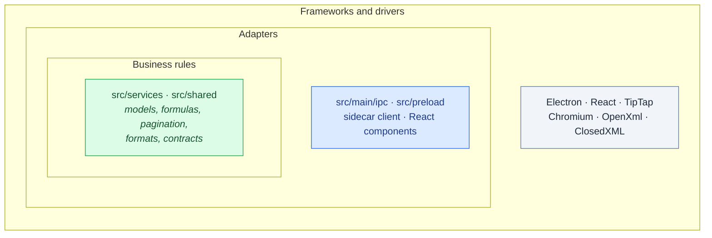

# Contributing to Librevia

**English** · [Português (Brasil)](CONTRIBUTING.pt-BR.md)

Thanks for your interest. This guide explains how to report a problem, how to prepare a change
and which standards the code follows. Most of these standards are checked by machine: if
`npm run verify` passes, the change is already almost entirely within them.

---

## 📑 Index

- [The most useful report](#the-most-useful-report)
- [Set up the environment](#set-up-the-environment)
- [Before opening the pull request](#before-opening-the-pull-request)
- [Principles](#principles)
  - [Clean Code](#clean-code)
  - [Clean Architecture](#clean-architecture)
  - [SOLID](#solid)
  - [Other good practices](#other-good-practices)
- [Layer boundaries](#layer-boundaries)
- [Function size and complexity](#function-size-and-complexity)
- [Search before you write](#search-before-you-write)
- [Contracts that change together](#contracts-that-change-together)
- [Interface text](#interface-text)
- [Tests](#tests)
- [Dependencies](#dependencies)
- [Language](#language)
- [Commits](#commits)

---

## The most useful report

**It is a file that did not open right.** The project is calibrated with real documents, and
every `.docx` or `.xlsx` that behaves unexpectedly teaches more than a new feature.

Use the **"File that opened wrong"** template when opening the issue.
If you can, attach the file. If it is confidential, describe what Word or LibreOffice shows and
what Librevia showed.

Security flaws do **not** go in a public issue: see the [security policy](SECURITY.md).

---

## Set up the environment

You need **Node.js 22** or newer and the **.NET 10 SDK**.

```bash
git clone https://github.com/VStorch/LibreviaWorkspace.git
cd LibreviaWorkspace
npm install
npm run sidecar:build   # publishes the .NET format service
npm run dev             # opens the application with automatic reload
```

The full list of commands is in the [README](README.md#rodando-localmente).

---

## Before opening the pull request

```bash
npm run format:check
npm run verify
```

These are the same checks CI runs: formatting, types, lint, TypeScript and .NET tests, licenses
and translations. If they pass on your machine, they pass in CI. To fix formatting,
`npm run format`.

If the change touches the interface, also run the end-to-end tests:

```bash
npm run e2e
```

The pull request template has a short checklist.

---

## Principles

Why does a personal project care so much about the shape of the code? Because a document editor
is large and lives a long time. Most of the work on it is not writing new code: it is **reading**
existing code to change one part without breaking another. Code that is easy to read is cheap to
change.

The principles below are how that is kept. Each comes with what it means and where it shows up in
Librevia. The practical rules in the following sections are their application.

### Clean Code

"Clean code" is code another person understands on the first read, without having to ask whoever
wrote it. It is not a single rule, but a set of habits:

| Habit | What it means | How it shows up here |
| --- | --- | --- |
| **Names that say what the thing is** | whoever reads the name does not need to open the function to know what it does; no `data`, `tmp`, `x2` or abbreviations only the author understands | `recalculate`, `discardDraft`, `MAX_FILE_BYTES`, `PATH_NOT_AUTHORIZED` |
| **Small functions that do one thing** | if a function's description needs an "and", it is probably two functions | the [size and complexity limits](#function-size-and-complexity), enforced by lint |
| **Few parameters** | a call with seven positional arguments makes the reader count commas; an object with names explains itself | `max-params` 5; above that, an options object, as in `usePagination` |
| **No magic numbers** | a loose `20971520` says nothing; `MAX_FILE_BYTES` says what it is and changes in one place only | named constants for limits, format versions and warning labels |
| **The code explains itself** | if a passage needs a comment to be understood, it is the passage that needs to improve: a better name, an extracted function, a named constant. A comment ages without the compiler noticing; the code does not | the *why* lives in the name, the test and the commit. A behavior copied from Excel becomes a test whose name describes it, for example "`=-2^2` is 4, as in Excel" |
| **No hidden effects** | a function called `formatCell` writes nothing to disk; the name promises, and the body delivers | the pure logic in `src/services/` does not touch the disk, the network or the screen |
| **Errors handled on purpose** | the error has a type and a message the person understands, instead of a generic exception swallowed or propagated without context | `AppError` with `ErrorCode`; in the spreadsheet, an error is a value (`#DIV/0!`) and propagates without bringing down the calculation |
| **No duplication** | the same rule written in two places diverges on the first rushed change | the `Inventory.cs` labels are constants; the interface text lives in a single catalog; [search before you write](#search-before-you-write) |
| **Leave it better than you found it** | when touching a file, fix what is within reach — a bad name, a comment that only repeats the code | the size and complexity lint has no exceptions list |
| **Formatting nobody argues about** | the formatter decides spaces and line breaks, and the review talks about what matters | Prettier, checked in CI |

#### When a comment still belongs

A comment is the exception, for what the code **cannot say**:

- an outside constraint, such as a callback signature the library imposes;
- counterintuitive behavior that Word, Excel or the format requires, when neither the name nor
  the test makes it clear to whoever reads that passage;
- the reason for an `eslint-disable`.

In these cases, the comment says **why**, never **what**. A comment that repeats the code,
narrates the history of the change or keeps disabled code is deleted.

### Clean Architecture

"Clean architecture" is a way of organizing code in layers so that **business rules do not
depend on technical details**. Picture circles, one inside the other:



- **The business rules sit at the center**: how a formula is calculated, where a page breaks,
  what a `.sdoc` stores. It is the part that gives the program its value and the one that should
  change least for technical reasons.
- **Around it are the adapters**, which translate between the center and the outside world: the
  IPC channel, the preload, the sidecar client, the screen components.
- **At the edge are the frameworks**: Electron, React, TipTap, the format libraries.

The rule that holds everything together is the **dependency rule**: code may only depend on what
is **further in**. The center does not know Electron, React or the disk exist. That is why:

- **business rules are tested with nothing around them.** Unit tests run in a few seconds,
  without opening a window;
- **swapping a technical detail does not touch the center.** The formula engine does not know
  whether the spreadsheet came from an `.xlsx` or an `.ssheet`, nor whether it goes to the screen
  or to paper;
- **data crosses the boundaries in simple, validated formats**: objects checked by Zod schemas
  over IPC, JSON and bytes in the sidecar protocol.

In Librevia this rule **does not depend on goodwill**: lint rejects an `import` that points
outward. The [layer boundaries](#layer-boundaries) table is the dependency rule written as
configuration.

There is one deliberate concession: the editor extensions (`src/renderer/document/extensions/`)
live attached to ProseMirror, because it is ProseMirror that calls their code. What is a real
rule — numbering a list, deciding a page break — moves from there to `src/services/` whenever
possible.

### SOLID

Five design principles, known by their initials:

| Principle | What it means | How it shows up here |
| --- | --- | --- |
| **S** — Single responsibility | a part of the code has only one reason to change | the sidecar only reads and writes formats; main writes to disk; the renderer draws |
| **O** — Open/closed | behavior can be added without rewriting what already works | a new spreadsheet function is one more definition in the catalog; the formula evaluator does not change |
| **L** — Liskov substitution | whoever implements a contract can stand in for another without surprises | every spreadsheet function follows the same contract (`FunctionDefinition`), and the evaluator calls `SOMA` and `PROCV` the same way |
| **I** — Interface segregation | nobody depends on what they do not use | the preload exposes only `window.api`, with the channels the screen needs, not all of Electron |
| **D** — Dependency inversion | the rule receives the details from outside instead of fetching them itself | `recalculate` receives the clock (`now`) as a parameter, which is why `HOJE()` is tested with a fixed date |

### Other good practices

- **Simple before clever (KISS).** The simplest solution that solves the problem is the best one
  until proven otherwise.
- **Only what is needed now (YAGNI).** No code is written for a use that might come. An
  abstraction is born when the second case shows up, not before.
- **Validate at the boundary, trust inside.** Everything that comes from outside — IPC, file,
  protocol — is checked on the way in. Inside, the type guarantees the rest.
- **Fail early and clearly.** A `.sdoc` from a version newer than the application is refused with
  a message, instead of half-opened.
- **Strict types.** TypeScript in strict mode, with `noUncheckedIndexedAccess`, and no `any`. The
  compiler is the first reviewer.
- **Immutable by default.** Models with `readonly` fields: whoever receives a model does not
  change it behind the scenes. `recalculate`, for example, returns a new spreadsheet.
- **Secure by default.** Sandbox on, authorized paths, no network access. Every permission is
  granted, never assumed.
- **Measure before optimizing.** The performance decisions in the README came from measurements,
  not guesses.
- **Small change, with a test.** A commit does one thing and arrives with the test that proves it.

---

## Layer boundaries

The code has four parts, and each may only import what it needs:

| Folder | May import | May not import |
| --- | --- | --- |
| `src/services/`, `src/shared/` | only pure code | `electron`, `react`, `node:*`, `@main/*`, `@renderer/*` |
| `src/renderer/` | React, `@services/*`, `@shared/*` | `electron`, `node:*`, `@main/*` |
| `src/preload/` | `electron`, `@shared/*` | everything else |
| `src/main/` | everything | — |

Why? `services` and `shared` run on both sides and are tested without Electron. The renderer runs
isolated and talks to the rest only through `window.api`.

**Lint enforces this.** Whoever forgets gets the error from `npm run lint`, before any review.

---

## Function size and complexity

A very long function, or one with many paths, is hard to read and to test. The limits below came
from measuring the project's own code and are checked by ESLint in `src/` (tests are left out):

| Rule | Limit | What it measures |
| --- | --- | --- |
| `complexity` | 15 | possible paths through the function: each `if`, `case`, `&&`, `??` and loop adds one |
| `max-lines-per-function` | 80 | lines of code, not counting comments and blank lines |
| `max-depth` | 4 | blocks nested inside one another |
| `max-params` | 5 | parameters; above that, use an options object |

For comparison: the project's typical function has complexity 3 and 7 lines.

### No exceptions list

No function exceeds the limits, and there is no exceptions list: code above them fails, and the
way out is to split the function.

### When an exception is legitimate

Sometimes the signature is not ours. A ProseMirror callback, for example, takes six parameters
because the library passes six. In that case, turn the rule off **only on that line** and write
the reason:

```ts
// The signature is ProseMirror's, not ours.
// eslint-disable-next-line max-params
handleDoubleClickOn(view, _pos, node, nodePos, _event, direct) {
```

---

## Search before you write

The same logic should not exist in two places. A copy works on the day it is made, but on the
first fix one of them falls behind, and the two start behaving differently without anyone
noticing.

Before writing a helper function, search with `git grep` whether it already exists. Search for
what the function **does**, not only for the name you would give it.

### Where shared code lives

| To | Use | In |
| --- | --- | --- |
| escape text for HTML | `escapeHtml` | `src/services/html.ts` |
| convert units (mm, pt, px, twips) | the functions and constants | `src/services/units.ts` |
| cell reference (`B12`) and column letter | `parseRef`, `cellRef`, `columnIndex`, `columnName` | `src/services/spreadsheet/model.ts` |
| walk the document in an export | `plainText`, `walk`, `prepareExport` | `src/services/document/export-common.ts` |
| the window of whoever called an IPC channel | `windowOf` | `src/main/ipc/sender-window.ts` |
| OOXML units in the sidecar | `Unit` | `sidecar/src/Librevia.Format/Unit.cs` |
| a number without the locale's decimal comma, in XML | `Invariant` | `sidecar/src/Librevia.Format/Docx/InvariantText.cs` |
| read a part of a `.docx`, `.xlsx` or `.odt` in e2e | `entryOf` | `e2e/fixtures.ts` |
| `pdftotext`, `pdfinfo` and `soffice` in e2e | `hasPdftotext`, `pdfText`, `hasSoffice`… | `e2e/external-tools.ts` |

### When the function does not exist

- **The second time it is needed, extract it.** The first copy is the sign that the function has
  an owner. Move it to the module of the innermost layer that all its users can import (see the
  [boundaries](#layer-boundaries)) and delete the copies in the same commit.
- **Tests too.** A helper function repeated across several specs goes to a shared module in the
  test folder, such as `e2e/external-tools.ts`.
- **Same name does not mean same function.** Two functions with the same name that do different
  things are not duplication. Duplication is the same logic in two places.

---

## Contracts that change together

- **IPC:** every channel has a Zod schema in `src/shared/`, checked at both ends. New channel, new
  schema.
- **Sidecar protocol:** both sides, `src/main/sidecar/protocol.ts` and
  `sidecar/src/Librevia.Format/Protocol/Frame.cs`, change in the same commit. The
  `sidecar-real.test.ts` test talks to the real executable and catches the difference.
- **Own formats:** `.sdoc` and `.ssheet` have a version number. If what they store changes, bump
  the version and keep reading the old versions.
- **Loss warnings:** the `Inventory.cs` labels are constants holding the key in the `sidecar.ts`
  catalog. Use the constant; the sentence, in Portuguese and English, lives only in the catalog.

---

## Interface text

Every sentence the person reads comes from the catalog in `src/shared/i18n/catalog/`, with both
languages side by side:

```ts
'comments.action.reply': { pt: 'Responder', en: 'Reply' },
```

The compiler flags an entry missing one of the languages. `npm run i18n:check` flags a sentence
written directly in the code, outside the catalog.

---

## Tests

The test comes with the change, in the right layer:

| What changed | Where to test |
| --- | --- |
| business rule, model, formula, format | Vitest, next to the file (`*.test.ts`) |
| reading or writing DOCX and XLSX | xUnit, in `sidecar/tests/` |
| what only shows up with the application assembled | Playwright, in `e2e/` |

Business rules live in a pure layer precisely so they can be tested without starting Electron.

The real documents used to calibrate the project **do not go into the repository**. Tests that
depend on them are skipped when the `LIBREVIA_CORPUS_DOC` variable is not set.

### Fixing bugs

Every bug is fixed in two steps, in this order:

1. **Reproduce it in a test.** Write, in the layer from the table above, a test that shows the
   bug, and run it: it must fail, and for the bug's reason, not because the test is set up wrong.
2. **Fix it.** Change the code until the test passes, without changing what the test expects.

Why? The test that failed first proves it really reproduces the bug, and the one that passes
afterward proves the fix solves that case. It also stays as a guard: if the bug comes back, the
test catches it. The test name describes the correct behavior, and the test goes in the same
commit as the `fix`.

If the bug only shows up with a corpus document, reduce it to the minimum that reproduces it and
build that minimum inside the test itself.

---

## Dependencies

Before adding one, weigh what it brings along. Every production dependency goes through the
license gate (`npm run licenses:check` and `npm run sidecar:licenses`), which only accepts
permissive licenses — MIT, BSD, Apache-2.0, ISC and similar — and rejects a package that declares
no license.

---

## Language

- **Identifiers in English:** file, function, variable and type names.
- **The rare comments in English**, like the identifiers they accompany.
- **Tests in English:** names, descriptions and comments.
- **User-facing messages in Portuguese.**
- **Commits in English.**

---

## Commits

[Conventional Commits](https://www.conventionalcommits.org), with a scope whenever there is one:

```text
type(scope): description
```

- **Types in use:** `feat`, `fix`, `refactor`, `perf`, `test`, `docs`, `build`, `ci`, `chore`
  and `revert`.
- **Scopes:** come from the code itself, such as `docx`, `xlsx`, `styles`, `pagination`, `lists`,
  `sections`, `comments`, `revisions`, `notes`, `equations`, `sidecar`, `print` and `ui`.
- **The body is short, or there is none.** One or two sentences saying *why*, when the title is
  not enough. If the title already says it all, do not write a body.

```text
fix(docx): line height multiplies the font's height, not its size

LibreOffice puts 12.98 pt in Arial 10 pt; we were applying the factor to the size.
```

- **No footer:** no tool `Co-Authored-By` or automatic signature at the end of the message.
