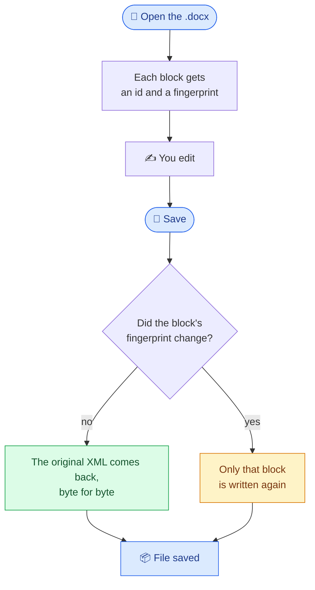
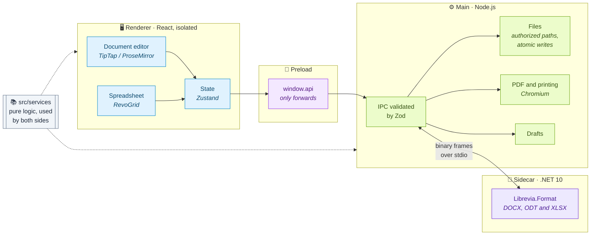
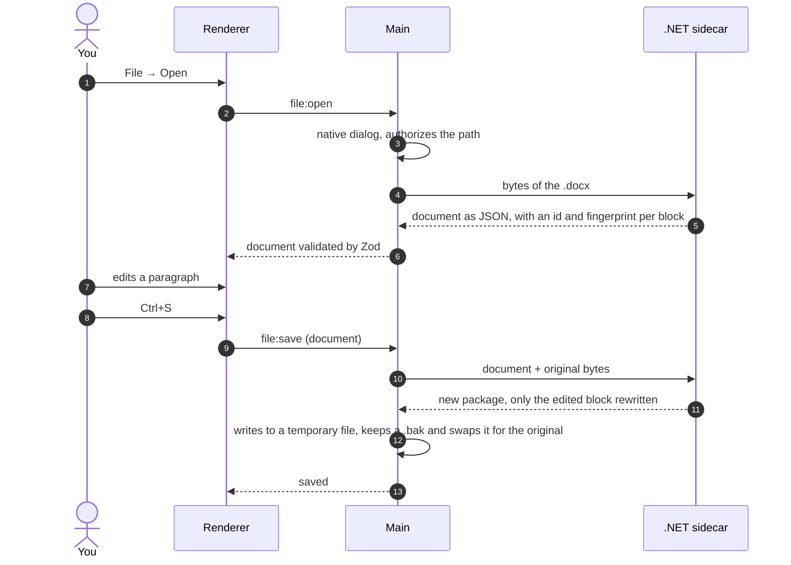
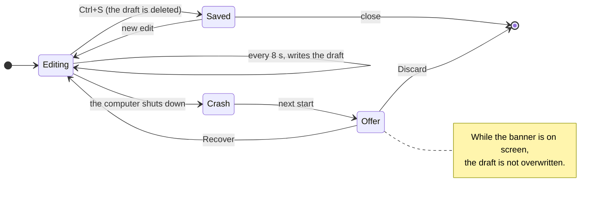
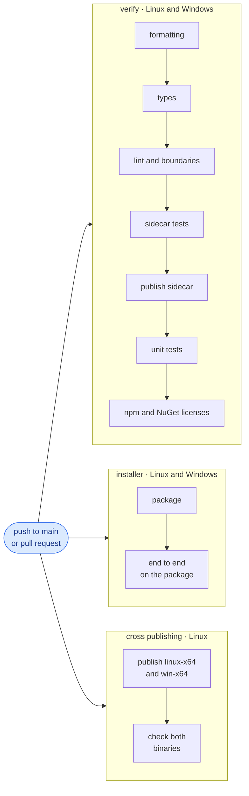

# Librevia

**English** · [Português (Brasil)](README.pt-BR.md)

Document and spreadsheet editor for the desktop. It works **without internet**, opens and saves
Word and Excel files and, when saving, **rewrites only what you edited**.

[](https://github.com/VStorch/LibreviaWorkspace/actions/workflows/ci.yml)


This README is for people who read or work on the code. If you only want to **use** the
application, read the **[manual](MANUAL.md)**.

---

## 📑 Contents

**Get to know it**

- [What Librevia is](#what-librevia-is)
- [What it does](#what-it-does)
- [Formats](#formats)
- [Saving does not cost what you did not edit](#saving-does-not-cost-what-you-did-not-edit)
- [Formulas in Portuguese](#formulas-in-portuguese)

**Inside**

- [Architecture](#architecture)
- [Code map](#code-map)
- [Why there is .NET in an Electron project](#why-there-is-net-in-an-electron-project)
- [The screen is the printed sheet](#the-screen-is-the-printed-sheet)
- [Reading and changing a PDF](#reading-and-changing-a-pdf)
- [Recovery after a crash](#recovery-after-a-crash)
- [Languages and appearance](#languages-and-appearance)
- [Performance, measured](#performance-measured)

**Working on the code**

- [Requirements](#requirements)
- [Running locally](#running-locally)
- [Tests](#tests)
- [CI/CD](#cicd)
- [Packaging](#packaging)
- [Code rules](#code-rules)
- [Known limits](#known-limits)
- [Where to learn more](#where-to-learn-more)
- [Contributing](#contributing)
- [License](#license)

---

<a id="what-librevia-is"></a>

## 💡 What Librevia is

Anyone who has opened a `.docx` in an editor other than Word and saved it knows the problem. The
text is still there, but the comments are gone, the revisions disappear, a footnote turns into
plain text. Nobody warned you.

Why does this happen? Most editors read the file, build their own version of it and, when
saving, **write everything again** from that version. Whatever the editor did not understand on
reading does not come back on writing.

Librevia does the opposite. It keeps the original file and, when saving, replaces only the parts
you changed. The rest comes back byte for byte, as it was.

Picture a printed book in which you correct one paragraph. A regular editor would retype the
whole book to change one sentence. Librevia replaces only the corrected page and hands back the
others as they came.

It also:

- **does not use the network**, not for spelling, not for fonts, unless you turn on an AI
  assistant;
- **warns before losing anything**, and says what;
- **keeps a draft** every eight seconds, in case the computer shuts down.

---

<a id="what-it-does"></a>

## 📌 What it does

### Documents

| Area | What it delivers |
| --- | --- |
| **Text** | fonts, sizes, colors, highlight, all caps, small caps, superscript and subscript |
| **Styles** | the document's own styles; apply, change and create; new documents in Calibri 11 |
| **Paragraph** | indentation, spacing, alignment, widows and orphans, keep with next |
| **Lists** | multilevel lists numbered as in Word; restart, continue and change the format |
| **Page** | real sheets on screen, header, footer, page numbering, margins, orientation, zoom from 50 % to 200 % |
| **Sections and columns** | each section with its own paper and margins; text in columns |
| **Tables and images** | insert and edit; table header repeated on each sheet; images anchored in the text |
| **References** | navigation pane, table of contents, bookmarks, captions, cross-references and fields that show the properties in the text |
| **Notes** | footnotes and endnotes, edited at the foot of their own sheet |
| **Review** | comments with replies and resolution; tracked changes as you type; accept and reject |
| **Equations** | shows Word's equations and lets you write new ones in LaTeX |
| **Templates** | creates documents from Word (`.dotx`) and ODF (`.ott`) templates; four come with the application |
| **Tools** | Portuguese spell checking without internet, find and replace, word count, special characters, typographic autocorrect |
| **AI assistant** | optional and off by default: rewrites, summarizes, proofreads or translates the selected passage, with the open document as context and with permission for those outside the computer; the answer arrives formatted (bold, headings, lists) and goes in as a tracked change. In the spreadsheet, it explains and creates formulas and fills columns, with a preview before writing. It works with Ollama and LM Studio, on this computer, with Claude Code, with agents that speak the ACP protocol (Gemini CLI, Codex and others) or with a cloud service. External programs, such as Claude Code, can read the open document and leave revisions and comments through the MCP protocol, without using the network; in the spreadsheet, they read the cells and propose writes, which you apply or discard |

### Spreadsheets

| Area | What it delivers |
| --- | --- |
| **Grid** | range selection, fill handle, clipboard; opens 20-thousand-row spreadsheets |
| **Structure** | tabs, freeze rows and columns, insert and delete rows and columns |
| **Formatting** | number, currency, percentage, date and text; bold, italic, underline, colors, alignment and borders |
| **Formulas** | 52 functions in Portuguese and English, references across tabs, formula bar |

### Around both

| Area | What it delivers |
| --- | --- |
| **PDF and printing** | documents and spreadsheets, with header, footer, numbering, margins and orientation; the exported PDF carries the properties |
| **PDF reader** | opens PDFs, including password-protected ones; edits the properties and says how many earlier versions the file keeps |
| **Properties** | summary, custom properties and statistics, in documents and spreadsheets |
| **Personal data** | the inspector finds and removes names, folders, thumbnail and photo metadata from a `.docx`, `.odt` or `.xlsx` |
| **Export** | document to PDF, HTML, Markdown and ODT |
| **Recovery** | a draft every eight seconds, offered back after a crash |
| **Read-only** | only locks the file when editing could erase something important in it |
| **Interface** | Portuguese or English; light, dark or system theme; reading mode |
| **Distribution** | AppImage, `.deb` and a Windows installer, with the third-party license notices |

---

<a id="formats"></a>

## 📄 Formats

| Extension | Opens | Saves | What it is |
| --- | :---: | :---: | --- |
| `.docx` | ✅ | ✅ | Word document; what you did not edit comes back intact |
| `.dotx` | ✅ | ✅ | Word template; opening it creates a new, untitled document |
| `.dotm` | ✅ | — | Word template with macros; opens like `.dotx`, but without the macros (the app warns) |
| `.xlsx` | ✅ | ✅ | Excel spreadsheet; what you did not edit comes back intact |
| `.sdoc` | ✅ | ✅ | Librevia document; keeps everything, without loss |
| `.ssheet` | ✅ | ✅ | Librevia spreadsheet; keeps everything, without loss |
| `.txt` | ✅ | ✅ | text only; saving to it discards the formatting, and the app warns first |
| `.pdf` | ✅ | exports | opens read-only; title, author, subject and keywords can be changed; documents and spreadsheets export to it |
| `.html`, `.md` | — | exports | document on a single page, or in Markdown with the images in a folder next to it |
| `.odt` | ✅ | ✅ | LibreOffice document; what you did not edit comes back intact |
| `.ott` | ✅ | ✅ | LibreOffice template; opening it creates a new, untitled document |

`.odt` follows the same surgical save as `.docx`: each block of `content.xml` gets an identifier on
opening, and the block you did not edit comes back with the exact text it had. What Librevia shows
and what it only preserves is in the [manual](MANUAL.md#libreoffice-documents-odt). `.ods`
spreadsheets do not open: the sidecar's spreadsheet library does not read the format.

---

<a id="saving-does-not-cost-what-you-did-not-edit"></a>

## 🔬 Saving does not cost what you did not edit

It is the reason the project exists.

When the file opens, each paragraph, table or block gets two things: an **identification
number** and a **fingerprint**, a short summary of the content. If the content changes, the
fingerprint changes with it.

At save time, Librevia compares the fingerprints. An unchanged block comes back with the original
XML. Only the different block is written again.



The numbers below were measured:

| Scenario | Result |
| --- | --- |
| 105-block document, saved without editing | **0** blocks rewritten |
| The same document, with one paragraph edited | **1** block rewritten |
| Package parts that change | only `word/document.xml`; the other 25 come out identical byte for byte |
| LibreOffice document (`.odt`, 7 blocks), saved without editing | **0** blocks rewritten; the 9 parts come out identical |
| The same `.odt`, with one paragraph edited | **1** block rewritten; only `content.xml` changes |
| LibreOffice spreadsheet, opened and saved without editing | **0** cells written, 18 preserved |
| The same spreadsheet, with one quantity changed | **4** cells: the one typed and the three formulas that depended on it |

Librevia does not need to understand Word's whole format to be faithful to it. It only needs not
to touch what you did not touch.

### Three kinds of warning

Picture three situations. In the first, the file has something Librevia cannot draw, but that
will stay there. In the second, something will vanish if you edit a specific passage. In the
third, what may vanish is important enough to be worth locking the file.

The risks are different, so the warnings are too:

| Warning | What it means | Examples |
| --- | --- | --- |
| **Invisible** | stays in the file, but the editor does not draw it | a shape's gradient or shadow; the part of an equation the screen cannot draw |
| **Loss** | vanishes on save, but only if you edit the passage it is tied to | the formatting from before a revision, in the paragraph you rewrote |
| **Structural loss** | the kind of loss that **locks the file** as read-only | calculated fields the editor does not recompute, content controls, structural revisions (such as a cell inserted into a table) |

If every warning said the same thing, the user would learn to close them without reading.

<details>
<summary><b>Why read-only exists, and why it is not a padlock</b></summary>

Losing **appearance**, such as the exact position of an image, locks nothing. Almost every
company document has an anchored image; locking for that would block everyday use, and the user
would learn to unlock without reading.

When the file carries a structural loss, it opens locked, and a banner says **exactly what is at
stake**. A click on "Editar mesmo assim" (edit anyway) unlocks that file, and only that one.

The classification lives in `Inventory.cs`. The labels are **constants** used by the format
readers. If they were loose sentences, changing one of them in one place would make the document
open editable without anyone noticing. Because they are constants, the compiler does not allow
it.

</details>

<details>
<summary><b>The personal data inspector follows the same rule</b></summary>

Cleaning works part by part in the package: a document with no thumbnail or names in
`word/document.xml` comes out with that part identical byte for byte. In a photo, the EXIF, the
XMP and the comments go; the pixels, the color profile and the orientation stay. The file starts
storing the request not to record names (`w:removePersonalInformation` in Word, `filterPrivacy` in
Excel), which Word, Excel and Librevia respect. ODF has no such request; Librevia writes its own
in `settings.xml`. What the inspector looks for is in the
[manual](MANUAL.md#inspect-document).

</details>

<details>
<summary><b>Properties too</b></summary>

Properties live in three parts of the package: the summary in `docProps/core.xml`, the company,
manager and statistics in `docProps/app.xml`, and the custom ones in `docProps/custom.xml`.
Changing only the status rewrites only `core.xml`; the other two come back byte for byte.

The statistics (pages, words, characters and paragraphs) are only written when the text changed.
If you only changed the title, `app.xml` stays as it was, with the numbers Word wrote.

</details>

<details>
<summary><b>In XLSX the care is with the cell</b></summary>

The file says `SUM(A1,B1)`; the screen shows `SOMA(A1;B1)`. The translation happens in one place
only, on the way between the main process and the format service, and it is done **character by
character**.

Why not rebuild the formula from what was understood? Because that would change spaces and
capitalization. Every cell would look different, and opening and saving without editing would
rewrite the whole spreadsheet, erasing font, vertical alignment, indentation and diagonal
borders.

The spreadsheet library used in the sidecar **preserves the package parts it does not
understand**. Charts and pivot tables survive that way. What it rewrites is the sheet itself,
hence the cell-by-cell comparison.

</details>

---

<a id="formulas-in-portuguese"></a>

## 🧮 Formulas in Portuguese

```excel
=SOMA(1,5;2)      → 3,5
=SE(A1>10;"alto";"baixo")
=PROCV("Ana";A1:C50;3;FALSO)
```

**The comma is the decimal separator, and the semicolon separates the arguments.** It is the rule
of Excel in Portuguese. If the comma already marks the decimal, it cannot separate anything else.

Whoever writes `SOMA(A1,B1)` gets a sentence saying which separator is right, not a generic
error.

- **52 functions**, in six groups: [full list in the manual](MANUAL.md#available-functions).
- **Two languages:** `SOMA` and `SUM` are the same function, as are `SE` and `IF`, `PROCV` and
  `VLOOKUP`.
- **An error is a value:** `=A1/0` gives `#DIV/0!`, and the error passes on to whatever depends
  on the cell, without stopping the calculation of the rest.
- **References follow the structure:** inserting a row fixes the formulas, even those in other
  tabs. Renaming a tab fixes the formulas that mention it.
- **The fill handle carries the formula:** `=B2*C2` dragged down becomes `=B3*C3`; a reference
  with `$` does not move.

<details>
<summary><b>Excel behaviors copied on purpose</b></summary>

They are:

- `=-2^2` is **4**;
- `="a"="A"` is true, but `=1="1"` is false;
- text inside a range is ignored by `SOMA`, but converted when passed directly;
- `PROCV` looks for an approximate value, unless the exact one is requested.

The criterion is a single one: the same file must give the same number in both programs.

The exception is `#CIRC!`, which Excel does not have. There, a circular reference shows zero and
opens a warning, and the zero stays in the spreadsheet as if it were a result.

</details>

---

<a id="architecture"></a>

## 🧱 Architecture

The application has four parts. Each may only do what it needs, and talks to the others through
a narrow channel.



| Part | What it does | What it may not do |
| --- | --- | --- |
| **Renderer** | draws the interface and edits | touch the disk or import `electron` and `node:*` |
| **Preload** | exposes `window.api` | have logic; it only forwards |
| **Main** | opens windows, reads and writes files, prints | accept a path the user did not choose; access the network outside `src/main/ai/` |
| **Sidecar** | reads and writes DOCX, ODT and XLSX | access the network or write to disk |

### One open and one save, step by step



### Two locks in the main process

They hold even if a malicious document manages to control the interface:

- **Saving** (`file:save`) only accepts paths authorized in this session, that is, opened or
  chosen by the user in a system dialog.
- **Opening from recents** (`file:open-recent`) only accepts paths already in the recent files
  list.

Any other path is refused with `PATH_NOT_AUTHORIZED` before reaching the disk.

The window runs with `contextIsolation` and `sandbox` on and `nodeIntegration` off. A test locks
these options: if someone turns one of them off, `security-policy.test.ts` fails.

---

<a id="code-map"></a>

## 🗺️ Code map

The code is TypeScript and C#, and about a third of it is tests. This is the list of the folders
that matter and what each one holds.

### Root

| Folder | Contents |
| --- | --- |
| [`src/main/`](src/main) | Electron main process: windows, menu, files, printing, IPC |
| [`src/preload/`](src/preload) | the `contextBridge` bridge, in a single file |
| [`src/renderer/`](src/renderer) | React interface: document editor, spreadsheet, start page |
| [`src/services/`](src/services) | pure logic: models, formats, formulas, pagination, export |
| [`src/shared/`](src/shared) | IPC contracts, Zod schemas, errors, shortcuts and the translation catalog |
| [`sidecar/`](sidecar) | .NET format service, with its own tests |
| [`e2e/`](e2e) | end-to-end tests with Playwright, on the assembled application |
| [`resources/`](resources) | fonts, dictionary, templates and the sidecar binaries that go in the installer |
| [`scripts/`](scripts) | icon, license notices, sidecar publishing, translation checks |

### Main process — `src/main/`

| Folder or file | Contents |
| --- | --- |
| [`index.ts`](src/main/index.ts), [`window.ts`](src/main/window.ts) | application start and window creation |
| [`menu.ts`](src/main/menu.ts), [`context-menu.ts`](src/main/context-menu.ts) | native menu and right-click menu |
| [`ipc/`](src/main/ipc) | one file per group of channels: file, editing, export, printing, PDF, personal data, drafts, templates, window |
| [`fs/`](src/main/fs) | path authorization, atomic writes, recents, drafts, 20 MB limit |
| [`sidecar/`](src/main/sidecar) | finds the .NET executable, starts the process and speaks the frame protocol |
| [`docx/`](src/main/docx), [`odt/`](src/main/odt), [`xlsx/`](src/main/xlsx) | the TypeScript side of each format, including formula translation |
| [`opened-original.ts`](src/main/opened-original.ts) | the bytes of the opened file, which the surgical save compares against |
| [`print/`](src/main/print), [`pdf-metadata.ts`](src/main/pdf-metadata.ts) | PDF through `printToPDF`, then the properties written into it |
| [`pdf-scheme.ts`](src/main/pdf-scheme.ts), [`pdf-viewer.ts`](src/main/pdf-viewer.ts) | the PDF reader on its own origin, and the print window for a PDF |
| [`privacy.ts`](src/main/privacy.ts) | the personal data inspector, which reads the file saved on disk |
| [`preferences.ts`](src/main/preferences.ts), [`i18n.ts`](src/main/i18n.ts) | stored language and theme, and the native menu translation |
| [`security.ts`](src/main/security.ts), [`security-policy.ts`](src/main/security-policy.ts) | window preferences and navigation policy |
| [`spellcheck.ts`](src/main/spellcheck.ts), [`fonts.ts`](src/main/fonts.ts), [`system-fonts.ts`](src/main/system-fonts.ts) | offline spell checking and the font list |
| [`log.ts`](src/main/log.ts) | the error log, `librevia.log`, which stays on the computer |
| [`ai/`](src/main/ai) | the AI assistant: providers, encrypted keys, consent, cancellation and the local MCP server. It is the only folder that accesses the network |

### Interface — `src/renderer/`

| Folder | Contents |
| --- | --- |
| [`app/`](src/renderer/app), [`pages/`](src/renderer/pages) | the application shell, with the draft saving, and the start page |
| [`document/`](src/renderer/document) | the document editor: sheets, header and footer bands, notes, comments, dialogs |
| [`document/extensions/`](src/renderer/document/extensions) | TipTap extensions: pagination, styles, lists, fields, notes, equations, tracked changes |
| [`document/toolbar/`](src/renderer/document/toolbar) | the toolbar and the paragraph, table, image and link dialogs |
| [`spreadsheet/`](src/renderer/spreadsheet) | grid, formula bar, tabs and spreadsheet menus |
| [`state/`](src/renderer/state) | Zustand state: files, drafts, printing, theme, zoom, reading mode |
| [`components/`](src/renderer/components) | shared pieces: status bar, warning banners, template gallery, properties, personal data inspector |
| [`pdf/`](src/renderer/pdf) | the PDF reader frame and its search bar |
| [`pdf-viewer/`](src/renderer/pdf-viewer) | the isolated page that draws the PDF with pdf.js |
| [`ai/`](src/renderer/ai) | the AI assistant panel, the conversation, the proposals on the sheet and the replies to MCP programs |

### Pure logic — `src/services/`

| Folder | Contents |
| --- | --- |
| [`document/`](src/services/document) | document model, `.sdoc`, styles, pagination, lists, fields, notes, equations (LaTeX and MathML), HTML and Markdown export, reading the Markdown of the assistant's answers |
| [`spreadsheet/`](src/services/spreadsheet) | spreadsheet model, `.ssheet`, editing, filling, formatting, structure |
| [`spreadsheet/formula/`](src/services/spreadsheet/formula) | formulas: parsing, evaluation, recalculation, reference adjustment and the 52 functions |
| [`file/`](src/services/file) | accepted extensions, document properties, personal data and the inventory of what a file can lose |
| [`pdf/`](src/services/pdf) | page setup, in the units Chromium expects |
| [`spell/`](src/services/spell) | user dictionary |
| [`ai/`](src/services/ai) | requests to the AI assistant, document context and reading streamed answers |

### Sidecar — `sidecar/src/Librevia.Format/`

| Folder or file | Contents |
| --- | --- |
| [`Program.cs`](sidecar/src/Librevia.Format/Program.cs), [`Server.cs`](sidecar/src/Librevia.Format/Server.cs) | loop that receives requests on stdin and answers on stdout |
| [`Protocol/`](sidecar/src/Librevia.Format/Protocol) | format of the frames and messages |
| [`Docx/`](sidecar/src/Librevia.Format/Docx) | readers (`DocxReader`, `BodyReader`, `StyleReader`, `NotesReader`…), writers (`DocxWriter`, `ParagraphWriter`, `SectionWriter`…), equations (`OmmlMath`), revisions, templates, properties (`DocumentProperties`, `CustomProperties`) and the `Inventory` |
| [`Odt/`](sidecar/src/Librevia.Format/Odt) | reading and surgical saving of `.odt` and `.ott`, and creating a new ODT package |
| [`Xlsx/`](sidecar/src/Librevia.Format/Xlsx) | reading and writing spreadsheets and number formats |
| [`Pdf/`](sidecar/src/Librevia.Format/Pdf) | reading a PDF's structure and incrementally updating the title, author, subject and keywords |
| [`Privacy/`](sidecar/src/Librevia.Format/Privacy) | the personal data inspector: finds and removes names, folders, custom properties, the thumbnail and image metadata of a DOCX, ODT or XLSX |

---

<a id="why-there-is-net-in-an-electron-project"></a>

## 🔌 Why there is .NET in an Electron project

To replace only one block inside a `.docx`, you need to see Word's XML with all its types. The
library that does this well is Microsoft's `DocumentFormat.OpenXml`, under the MIT license. It is
.NET, hence the sidecar.

The sidecar is a **format service**, not a second application. Bytes come in on stdin and JSON
goes out on stdout. It opens no port, uses no network and writes nothing to disk; the main process
is still the one that writes, with the locks that already exist.

Each message goes in a **binary frame**:

```text
┌──────────────────┬──────────────────────┬────────┬───────────┐
│ JSON length      │ binary length        │  JSON  │  binary   │
└──────────────────┴──────────────────────┴────────┴───────────┘
```

Why not send one line of text per message? Because a `.docx` is a ZIP, full of line-break and
zero bytes. A protocol that separates messages by line would cut the file in half.

<details>
<summary><b>What happens if the sidecar crashes</b></summary>

The open document stays open. The operation in progress fails with a sentence you can
understand, and the next request starts a new process. The sidecar also shuts down on its own
when it loses stdin, so not even a `SIGKILL` on the application leaves a forgotten process.

The two sides of the protocol, `src/main/sidecar/protocol.ts` and
`sidecar/src/Librevia.Format/Protocol/Frame.cs`, **must change together**. What guarantees this
is `sidecar-real.test.ts`, which talks to the real published executable.

</details>

---

<a id="the-screen-is-the-printed-sheet"></a>

## 📏 The screen is the printed sheet

The editor breaks the text into sheets **line by line**, like Word and LibreOffice. A paragraph
can start on one sheet and end on the next, lone lines at the top or bottom of a sheet (widows
and orphans) are avoided, and a table's header repeats on each sheet.

In the 25 documents used for checking, the number of sheets is the same as in LibreOffice, and
each sheet starts with the same word.

No library generates the PDF: **Chromium** itself does, through `printToPDF`. The editor hands
over the document **already divided into sheets**, and each sheet becomes a box the size of the
paper. That is why the PDF comes out the same as the screen, with selectable text and embedded
fonts. `printToPDF` only writes the title; the author, subject and keywords from the properties
go in afterward, by [incremental update](#reading-and-changing-a-pdf), as in an opened PDF.

There used to be two paginators, the editor's and Chromium's, and they did not always agree. Now
there is only one.

> ⚠️ **When touching margins:** `printToPDF()` takes **inches** and `webContents.print()` takes
> **CSS pixels**. Both conversions live together in `services/pdf/page-setup.ts`, with a test
> that compares one with the other.

<details>
<summary><b>The fonts that come along</b></summary>

A document made in Calibri needs to take up the same space here, or the sheets do not match. The
installer brings free fonts with the **same metrics** as the Office fonts:

| Office font | Font that comes with Librevia |
| --- | --- |
| Calibri | Carlito |
| Cambria | Caladea |
| Arial | Liberation Sans |
| Times New Roman | Liberation Serif |
| Courier New | Liberation Mono |

</details>

---

<a id="reading-and-changing-a-pdf"></a>

## 📕 Reading and changing a PDF

To **read** a PDF, Librevia uses Mozilla's [pdf.js](https://mozilla.github.io/pdf.js/). It runs
in a frame with its own origin and process, without access to the rest of the application, and
reads the file in chunks: a 200 MB PDF opens in 0.3 s, reading 128 KB of it. The password of a
protected PDF goes from the dialog straight to that frame: it does not pass through the main
process and is not stored.

A PDF's **properties** (title, author, subject and keywords) are written by **incremental
update**, provided for in the PDF specification: the file's bytes stay as they were, and the new
information dictionary, the XMP, a cross-reference table and a trailer pointing to the previous
one go at the end. In a sample of ten PDFs, among them one of 33 MB and 1,282 pages, the update
took from 357 bytes to 4.6 KB. In an encrypted PDF, the change is refused; in a signed PDF, the
dialog warns beforehand that readers such as Acrobat will flag the change.

The same mechanism explains why the personal data inspector does not promise to clean a PDF: the
earlier version is still in the file. It counts the updates through the `/Prev` chain (a
linearized PDF starts with two sections, which do not count) and says how many earlier versions
the file keeps.

---

<a id="recovery-after-a-crash"></a>

## 💾 Recovery after a crash

Every eight seconds, what is on screen goes to a draft, **never to your file**. If the application
wrote to the file on its own, "I didn't save" would become "I saved by accident". Deciding when
to save is still up to you.



After a crash, the application offers the draft back in a banner with two actions. While the
banner is on screen, autosave **does not write**. Without this rule, whoever ignored the warning
and started typing would erase, within seconds, exactly the work the banner exists to give back.

Recovering also restores what was lost with the process: the authorization to write to that path
and the original bytes of the `.docx`. Without them, saving over the recovered file would be
refused, and the surgical save would have nothing to compare against.

---

<a id="languages-and-appearance"></a>

## 🌐 Languages and appearance

The interface speaks **Portuguese** and **English**, and the **View** menu changes the language,
the theme (light, dark or the system's) and turns on **reading mode**.

The interface text lives in a catalog in [`src/shared/i18n/`](src/shared/i18n), with both
languages side by side in each entry. Why only two, and not an open list? Because each new
language needs a translation in **every** entry, and the compiler flags the missing ones. A screen
half in one language and half in another is worse than having no translation.

The compiler guarantees every entry has both languages, but it does not know whether a sentence
was written directly in the code, never becoming an entry. For that there is
`npm run i18n:check`, which looks for Portuguese sentences outside the catalog.

---

<a id="performance-measured"></a>

## ⚡ Performance, measured

A spreadsheet of 20 thousand rows and **120 thousand cells**, with 20 thousand formulas,
generated by LibreOffice, opens in **about 3.5 s** from the click to the screen.

| Step | Time |
| --- | --- |
| Format service (ClosedXML reading the package) | 1.9 s the first time, 0.9 s afterward |
| `parseWorkbook` (validating 120 thousand cells with Zod) | 245 ms |
| `recalculate` (20 thousand formulas) | 279 ms |
| Converting the model to JSON (7.4 MB) | 50 ms |
| Draft of a 6-thousand-paragraph document | 4 ms, imperceptible |

<details>
<summary><b>Two decisions that came from this measurement</b></summary>

**Ahead-of-time compilation (ReadyToRun) in the sidecar, on.** Without it, the first open takes
3.8 s; with it, 1.9 s. Once warmed up, the precompiled code is about 100 ms slower than code
optimized at run time. Nobody notices 100 ms, but everyone notices the first open dragging. The
cost is 41 MB per platform.

**Number formats cached.** A large spreadsheet has half a dozen number masks and hundreds of
thousands of cells. Now each mask is parsed only once. The time left in that step is ClosedXML
building each cell's style.

</details>

---

<a id="requirements"></a>

## 🧰 Requirements

### To use

| System | Package | Note |
| --- | --- | --- |
| Linux x64 | AppImage | runs without installing |
| Linux x64 (Debian, Ubuntu and derivatives) | `.deb` | installs in the applications menu |
| Windows 10 or newer, x64 | NSIS installer | installs only for your user, without an administrator password |

The .NET runtime goes **inside** the installer. Users do not need to install anything besides it.

### To build

| Tool | Version | What for |
| --- | --- | --- |
| Node.js | 22 or newer | build, tests and Electron itself |
| .NET SDK | 10 | publishing and testing the sidecar |
| System | Linux or Windows | Windows is only needed to build the NSIS installer |

A Linux machine can publish the sidecar for both platforms; CI checks this.

---

<a id="running-locally"></a>

## ▶️ Running locally

```bash
# 1. clone and install
git clone https://github.com/VStorch/LibreviaWorkspace.git
cd LibreviaWorkspace
npm install

# 2. publish the .NET sidecar (downloads the NuGet packages the first time)
npm run sidecar:build

# 3. open the application in development mode, with automatic reload
npm run dev
```

### Commands

| Command | What it does |
| --- | --- |
| `npm run dev` | application in development mode, with automatic reload |
| `npm run build` | checks the types and generates the production build in `out/` |
| `npm test` | unit tests (Vitest) |
| `npm run sidecar:test` | sidecar tests (.NET) |
| `npm run e2e` | build and end-to-end tests on the assembled application |
| `npm run lint` | lint, including the boundaries between layers |
| `npm run i18n:check` | looks for interface text outside the translation catalog |
| `npm run verify` | types, lint, tests on both sides, licenses and translations |
| `npm run format:check` | checks formatting, which `verify` does not cover; `npm run format` fixes it |
| `npm run dist` | AppImage and `.deb` installers in `release/` |
| `npm run dist:win` | NSIS installer (running on Windows) |

> `npm run verify` publishes the sidecar before the tests, because one of them talks to the real
> executable.

---

<a id="tests"></a>

## 🧪 Tests

There are three layers, and each proves something the previous one cannot reach:

| Layer | Tool | What it proves |
| --- | --- | --- |
| **Unit** | Vitest | pure logic, main process, IPC contracts |
| **Sidecar** | xUnit (.NET) | reading and writing DOCX, ODT, XLSX and PDF, round trip byte for byte |
| **End to end** | Playwright + Electron | the assembled application, with the isolated preload and the published sidecar |

Together, they add up to more than 2 thousand.

Some end-to-end tests use real documents, which do not go into the repository. They are
**skipped** when the `LIBREVIA_CORPUS_DOC` variable does not point to one of those files.

The end-to-end tests also run on the **assembled package**. It is the difference between "the
tests pass" and "the installer works":

```bash
npm run dist
LIBREVIA_E2E_BINARY=release/linux-unpacked/librevia npm run test:e2e
```

---

<a id="cicd"></a>

## 🔄 CI/CD

GitHub Actions runs on every push to `main` and on every pull request.



| Job | Why it exists |
| --- | --- |
| `verify` | runs on **both systems**, because the sidecar starts a child process and resolves paths, two things that change from one system to the other |
| `instalador` (installer) | proves that the resources, the asar and the sidecar binary are still where the code expects them **after packaging** |
| `publicacao-cruzada` (cross publishing) | proves that a single machine can publish the binaries for both platforms |

---

<a id="packaging"></a>

## 📦 Packaging

`npm run dist` generates the AppImage and the `.deb`; `npm run dist:win` generates the NSIS
installer. Besides the application, the installer carries:

| Resource | Where it comes from |
| --- | --- |
| sidecar binary, only the platform's | `resources/sidecar/` |
| fonts with the metrics of the Office ones | `resources/fonts/` |
| Brazilian Portuguese dictionary | `resources/dictionaries/` |
| templates: blank, letter, report and meeting minutes | `resources/templates/` |
| third-party license notices | `THIRD-PARTY-NOTICES.md` |

The sidecar stays **outside** the asar. An executable inside a compressed archive does not run.

On Linux, the application registers for `.docx`, `.dotx`, `.odt`, `.ott`, `.xlsx`, `.txt` and
`.pdf`; on Windows, for `.docx`, `.dotx`, `.odt`, `.ott` and `.xlsx`.

`npm run notices` generates `THIRD-PARTY-NOTICES.md`. It covers **three** sets: the production
npm dependencies, the whole of Electron (with Chromium and Node.js) and the sidecar's NuGet
packages, which carries the .NET runtime along. The `licenses:check` gate only looks at the first.
Leaving the other two out would give the impression of being up to date without being so.

The icon is drawn in `build/icon.svg`. `npm run icon` generates `build/icon.png` from it.

---

<a id="code-rules"></a>

## 📐 Code rules

The code follows **Clean Code**, **Clean Architecture** and **SOLID**, and most of the rules are
checked by machine. `npm run verify` fails on:

- an `import` that crosses the boundaries between layers (the renderer importing `electron`, for
  example);
- a function above the size and complexity limits;
- types that do not check, failing tests, interface text outside the catalog;
- a dependency without a declared permissive license.

The details, with examples, are in [CONTRIBUTING](CONTRIBUTING.md#principles).

<details>
<summary><b>Why the license gate rejects packages that declare no license</b></summary>

The application is meant for use in companies. A GPL or AGPL dependency slipping in by accident
is a legal problem, not a technical one. The gate covers npm and NuGet, and rejects a package
that **declares no SPDX license**, not only one that declares a forbidden one.

That is how Six Labors' license change was discovered, from Apache-2.0 to a license of its own, in
an indirect dependency of ClosedXML. Whoever only looks for forbidden licenses does not see a
change like that coming.

</details>

---

<a id="known-limits"></a>

## 🚧 Known limits

The main ones: `.ods` does not open, a `.dotm`'s macros are left out, the spreadsheet does not
merge cells yet and files over 20 MB do not open. The full list, with what to do in each case, is
in the [manual](MANUAL.md#known-limits).

---

<a id="where-to-learn-more"></a>

## 📚 Where to learn more

| Where | What it has |
| --- | --- |
| [`MANUAL.md`](MANUAL.md) | how to use it: shortcuts, formatting, formulas, warnings, export |
| [`CONTRIBUTING.md`](CONTRIBUTING.md) | how to report a problem and prepare a change, and the code standards |
| [`SECURITY.md`](SECURITY.md) | how to report a security flaw privately |
| [`AGENTS.md`](AGENTS.md) | short instructions for coding agents working in the repository |
| `git log` | the reason for each decision, with the measurements |

---

<a id="contributing"></a>

## 🤝 Contributing

Librevia is **open source**, under the MIT license. You may use, study, modify and redistribute
it. Issues, ideas, reports of files that opened wrong and pull requests are welcome.

The most useful report is **a file that did not open right**: every real `.docx` or `.xlsx` that
behaves unexpectedly teaches more than a new feature. Before opening an issue or a pull request,
read [CONTRIBUTING](CONTRIBUTING.md). Security flaws do not go in a public issue; see the
[security policy](SECURITY.md).

---

<a id="license"></a>

## 📜 License

[MIT](LICENSE) — © 2026 Vinícius Storch.

The dependencies come with their own licenses, all permissive and checked on every build by
`npm run licenses:check`. The `THIRD-PARTY-NOTICES.md` that ships with the installer is generated
by `npm run notices` and covers the three distributed sets: npm packages, the whole of Electron
and the sidecar's NuGet packages.
